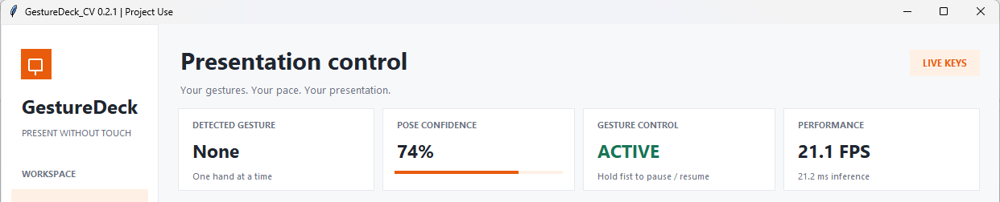
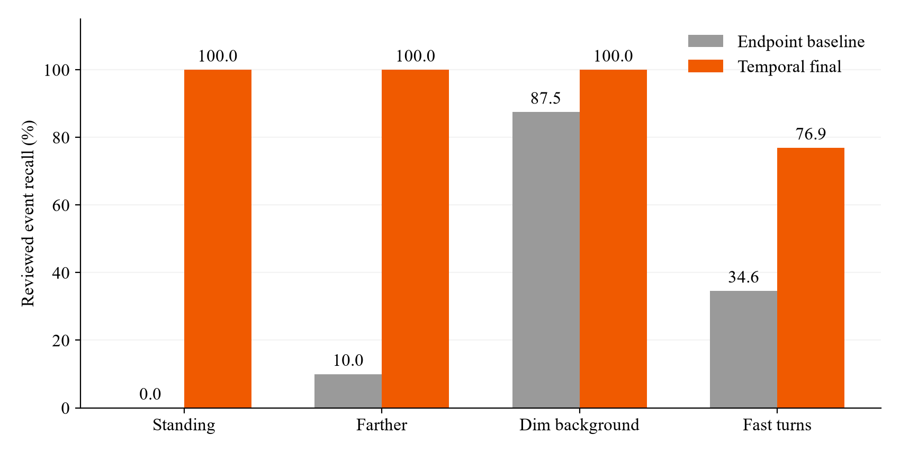

# GestureDeck

**A classroom computer vision prototype for controlling a Windows PowerPoint slideshow with an open right hand.**

GestureDeck combines a webcam, the pretrained MediaPipe Gesture Recognizer, and local geometric and temporal rules. Its white-and-orange desktop interface shows moving hand joints, recognition feedback, control state, and approximate live performance.



The screenshot shows an earlier session's instantaneous interface values. The measured final benchmark is reported below.

The current presentation mode is **Project Use**. The retained launcher is named **GestureDeck - Learned Trial** for compatibility, but its everyday interface uses right-hand palm/back turns. Historical swipe implementations remain in the source for research and evaluation.

## What to expect

- Open right-hand turns move one slide forward or backward.
- A held fist pauses or resumes gesture control.
- A held Victory pose exits the slideshow while leaving the presentation open.
- The preview shows actual detected joints, and optional local recording saves matching evidence.
- The app starts in dry run, with the session stopped, live keys unchecked, and recording off.

This is a guided classroom demonstration prototype. Fast turns can lose tracking and produce missed commands. Inspected trials do not establish general recognition accuracy or deployment reliability. The current palm-turn navigation does not use a custom trained temporal classifier.

## Requirements

| Component | Expected setup |
| --- | --- |
| Operating system | Windows x64 |
| Python | Python 3.11, as required by the project metadata |
| Presentation app | Desktop Microsoft PowerPoint for live slideshow control |
| Camera | A webcam accessible to Windows desktop apps |
| Compute | CPU inference; no GPU required by this implementation |
| Initial setup | Internet access for dependency installation and the explicit official-model download |

After setup, recognition runs locally. The app does not upload webcam footage or download models automatically at launch.

## Install from a fresh clone

Open PowerShell in the folder where you want the project:

```powershell
git clone https://github.com/v-Exor/GestureDeck_CV_Project.git
cd GestureDeck_CV_Project
git checkout v1.0
py -3.11 -m venv .venv
.\.venv\Scripts\python.exe -m pip install -r requirements-lock.txt
.\.venv\Scripts\python.exe -m pip install --no-deps -e .
.\.venv\Scripts\python.exe scripts\download_model.py
.\.venv\Scripts\python.exe -m pip check
```

The model downloader retrieves the official versioned MediaPipe task and verifies its pinned SHA-256. Model binaries and development environments are not committed. See [model provenance](models/README.md). If you already have the working development environment, keep using it rather than recreating it.

## Open Project Use

From the project root:

```powershell
& ".\.venv\Scripts\pythonw.exe" ".\GestureDeck-Learned Trial.pyw"
```

This opens the desktop app without a command window. If the **GestureDeck - Learned Trial** desktop shortcut already exists on your computer, use it. A Git clone does not include the original computer's desktop shortcut. Keep this as the single everyday launcher.

The retained launcher selects **Project Use**, an eight-second live countdown, and dry-run mode.

## First demonstration

1. Open a disposable PowerPoint deck and start its slideshow near the middle.
2. Open GestureDeck. First use **Recognition / dry run** to check the camera and joints without sending keys.
3. Select **PowerPoint / live keys** and check **Allow slide keys this session** when ready for real navigation.
4. Click **Start session**. Use **Alt+Tab** to focus the slideshow during the eight-second countdown.
5. Show your open right palm clearly to establish the initial side. This starting pose sends no navigation key.
6. Use the controls below. Keep the whole hand visible and show each flat endpoint clearly.
7. Return to GestureDeck and click **Stop session** when finished. Stop finalizes recordings and releases the camera.

Live keys require the focused PowerPoint slideshow. Its editor or another foreground app does not qualify. Clicking a slide may advance it, so Alt+Tab is the preferred way to restore slideshow focus.

## Gesture controls

| Input | Expected action |
| --- | --- |
| Open right hand, palm to back | NEXT slide |
| Open right hand, back to palm | PREVIOUS slide |
| First stable palm or back orientation | Establish the starting side, with no key |
| Hold either side stationary | No repeated navigation |
| Fist held for one second | Toggle pause or resume once |
| Victory held for two seconds | Exit the slideshow and leave control paused |

Lower the hand before reusing a held control pose. Confirmed opposite navigation turns can follow immediately. Turning back is a PREVIOUS action. To prepare another NEXT without reversing a slide, lower your hand and reset its orientation outside the camera view before showing the starting side again.

The pose-confidence display describes static-pose recognition. It is not a measured palm-turn accuracy percentage.

## Optional recording and moving joints

Recording is **off until enabled inside the app**. Check **Record webcam + landmarks locally** to capture evidence. Optionally check **Include PowerPoint slide snapshots**.

Each session stays beneath this project's `recordings/` folder:

| File | Contents |
| --- | --- |
| `webcam.avi` | Original webcam frames before drawing |
| `webcam_landmarks.avi` | Matching frames with actual detected joints and connections |
| `frames.jsonl` | Frame indexes, capture/decision times, landmarks, state and events |
| `commands.csv` | Recognized commands and delivery outcomes |
| `manifest.json` | Settings, dimensions, counts and completion status |
| `slides.jsonl` and `slides/` | Optional timed snapshots of the focused slideshow |

Use **Stop session** to finalize capture. Victory exits the slideshow but does not stop recording. Uncheck recording afterward. No microphone audio is captured. Recording does not train a model automatically.

Use joint-overlay videos and matching stills in demonstrations. Missing detections remain without a skeleton. Use JSONL capture timestamps for timing rather than nominal 20 FPS AVI playback. A successful key-delivery result alone does not prove a visible slide change.

Personal videos, full camera screenshots, reduced observations, individual command traces, timing samples, generated reports and local model binaries are excluded from this public source repository. Documentation includes aggregate results and selected non-personal illustrations. The teacher receives the evaluation data and joint-overlay videos through the separate submission package. See the [recording guide](docs/LANDMARK_RECORDINGS.md).

## Current demonstration results

The reviewed manual scope ends at fast turns: **11 cases, ten Pass outcomes and one fast-turn Fail outcome**, including three hard-condition cases.

| Inspected condition | Recognized physical turns |
| --- | ---: |
| Standing | 8 of 8 |
| Farther standing | 10 of 10 |
| Participant-described dim background | 8 of 8 |
| Fast turns, first four physical pairs | 5 of 8 |
| Fast turns, entire recorded sequence | 20 of 26 |

The full fast-turn sequence contains 13 visible cycles although four pairs were intended. It retains six missed turns. No wrong-direction or duplicate navigation commands were found in that inspected sequence. Twenty successful key deliveries produced 16 visible slide changes; four PREVIOUS deliveries occurred at the first-slide boundary.

These are reviewed functional observations from one participant. See the [recording results](docs/MILESTONE4_RESULTS.md) and the final experiment below.

## Reproduce the final results

The evaluation inputs are supplied privately in **GestureDeck_Evaluation_Data.zip**, inside the teacher submission package. Extract that ZIP into the repository root, preserving its `recordings/milestone5_evaluation_inputs/` folder. The public clone alone does not contain the study data.

After installing the pinned environment and adding those private inputs, run this one command from the repository root:

```powershell
.\.venv\Scripts\python.exe -m gesturedeck.final_evaluate --output recordings/milestone5_reproduced
```

Choose a new output folder on repeat runs. The command verifies input and analysis-source SHA-256 hashes, replays both methods on the same saved scalar observations, checks exact parity with captured navigation events, and writes `results.json` and `results_table.csv`. It needs no camera, PowerPoint or model binary.

| Method | Correct / physical turns | Precision | Recall | F1 |
| --- | ---: | ---: | ---: | ---: |
| Single-endpoint baseline | 17 / 52 | 100% | 32.69% | 0.4928 |
| Temporal final | 46 / 52 | 100% | 88.46% | 0.9388 |

The four inspected sessions contain 3,101 recorded frames and 26 NEXT plus 26 PREVIOUS turns. Final per-direction recall is 21/26 NEXT and 25/26 PREVIOUS. All six final misses occur in the fast-turn clip. No wrong-direction, duplicate or unmatched commands occur in this reviewed set. The baseline immediately resets its starting side on actual missing-hand observations and has no temporal confirmation or tracking-gap bridge. It is a minimal engineering comparator defined after the clips had been inspected.



**Evaluation scope:** labels were reviewed with predictions known, and these sessions had already been inspected during development. There is no current training, train/validation/test split or independent held-out claim. The 45.27 seconds of negative activity cannot establish the proposal's ten-minute false-command target. Successful key delivery and visible slide changes are separate outcomes.

**Fresh offline CPU benchmark:** Ryzen 5 3400G, 640 by 480, 1,307 measured frames after twenty warm-up frames per clip. Mean analysis time is **32.43 ms**, median **28.23 ms**, p95 **53.99 ms**, equivalent to **30.83 FPS** analysis throughput. Timing includes file decode, color conversion, fresh native inference and one method's processor. It excludes live camera, UI, joint drawing, recording, slideshow snapshots, sound, keys and physical slide latency. The reproduction command recomputes these statistics from pinned measured samples; it does not perform fresh inference or timing.

See [final reproduction details](docs/FINAL_REPRODUCTION.md) and [sample outputs](outputs/final/README.md). Data provenance and hashes accompany the privately supplied study. Keep the teacher package restricted to the intended recipients.

## Verify the source

After installation, run from the project root:

```powershell
.\.venv\Scripts\python.exe -m pytest -q
.\.venv\Scripts\python.exe -m pip check
.\.venv\Scripts\python.exe scripts\check_model.py
```

Tests exercise logic, mocked camera/key delivery, UI state, recording and replay. The model smoke check runs CPU inference on synthetic frames. These checks do not replace real-hand demonstration or independently measure slide-control accuracy.

The public checkout runs the synthetic/unit checks. One private-study integration test is skipped until the teacher's data ZIP has been extracted. With that data installed, the integration check also verifies the report's frozen results.

The existing `gesturedeck.evaluate` and `gesturedeck.reproduce_comparison` modules concern historical swipe studies. Their private assets are separate from the current reproducible palm-turn study in `gesturedeck.final_evaluate`. The final study reproduces saved-feature results and measured-sample summaries, rather than an end-to-end camera accuracy experiment.

## Project structure

```text
GestureDeck-Learned Trial.pyw   Retained desktop launcher
src/gesturedeck/
  desktop.py                  White-and-orange Project Use interface
  session.py                  Background capture and session lifecycle
  camera.py                   Webcam access and frame normalization
  recognizer.py               MediaPipe inference
  hand.py                     Hand geometry and extended fingers
  turn.py                     Palm/back transition rules
  processor.py                Navigation events and deliberate controls
  focus.py, controller.py     Guarded PowerPoint keys
  preview.py                  Hand landmark visualization
  recording.py                Raw and joint-overlay capture
  slideshow_recording.py      Optional visible slideshow snapshots
  annotate_recording.py       Offline overlay from saved landmarks
  final_evaluate.py           Hash-verified final palm-turn feature replay
  swipe.py, learned_swipe.py  Historical swipe implementations
scripts/                      Model setup and research/replay utilities
tests/                        Automated tests and synthetic fixtures
docs/                         Current usage, architecture and evidence notes
outputs/final/                Final numerical plots and sample outputs
recordings/                   Local captures and private evaluation inputs
models/README.md              Official model source and checksum
requirements-lock.txt         Pinned tested environment
pyproject.toml                Package metadata and entry point
```

See [architecture](docs/ARCHITECTURE.md) and [presentation mode](docs/PRESENTATION_MODE.md).

## Troubleshooting

| Symptom | Check |
| --- | --- |
| Missing model at startup | Run `scripts\download_model.py` from the project root |
| No webcam image | Close competing camera apps, check Windows desktop-camera access and choose the correct camera index/backend |
| Gestures appear but slides do not move | Choose live mode, allow keys, wait for countdown and focus the actual slideshow |
| A turn is missed | Keep the complete open right hand visible and show stable flat endpoints |
| Control stays paused | Lower the hand, then hold a fist for one second |
| Capture continues after Victory | Return to GestureDeck and click Stop session |
| No audio feedback | Check Windows sound output and use the visible control state |

## Team and final submission

| Member | Team-declared role |
| --- | --- |
| Keanne Jericho M. Rosario | System and logic creator: hand geometry, temporal navigation, controls, session state and presentation actions |
| Ella Edz A. Taquilid | Interface designer: white-and-orange layout, preview, recognition/status displays, gesture guide and session-control presentation |

See [contributions and real Git history](CONTRIBUTORS.md). The initial import records both members' work in one commit; it does not establish individual module authorship.

The final public source snapshot is tagged **v1.0**. The earlier **cp4-80** checkpoint remains preserved. The application's internal version label remains 0.2.1; v1.0 identifies the final coursework source snapshot. The separate teacher submission contains a final report PDF, twelve-slide PDF, editable originals, private evaluation inputs, joint-overlay stills and a silent 64.5-second backup demonstration. Live demonstration and classroom rehearsal still require the team and actual hardware.

Developed for **CSST 106 Computer Vision**.
